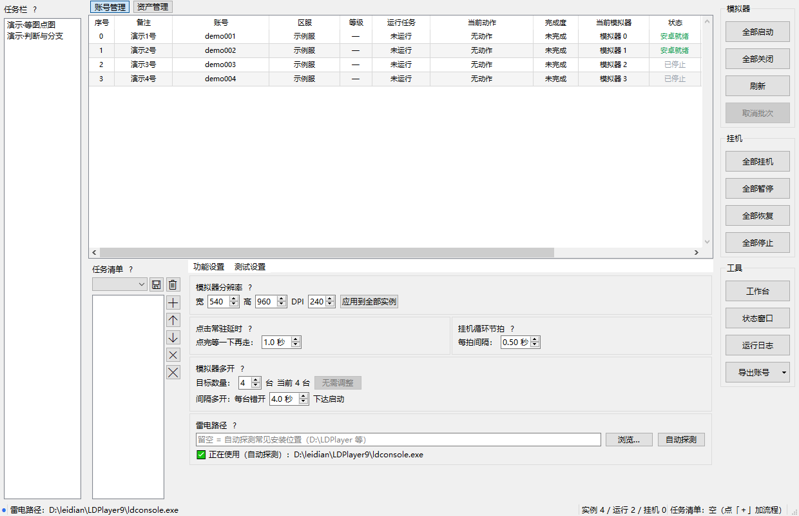
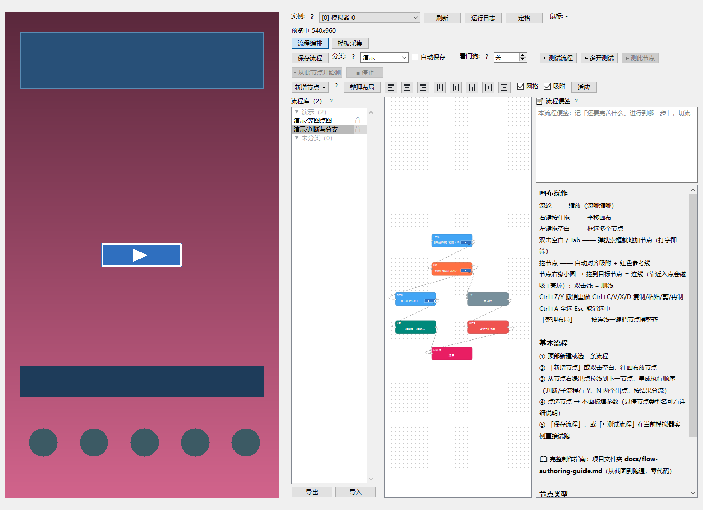
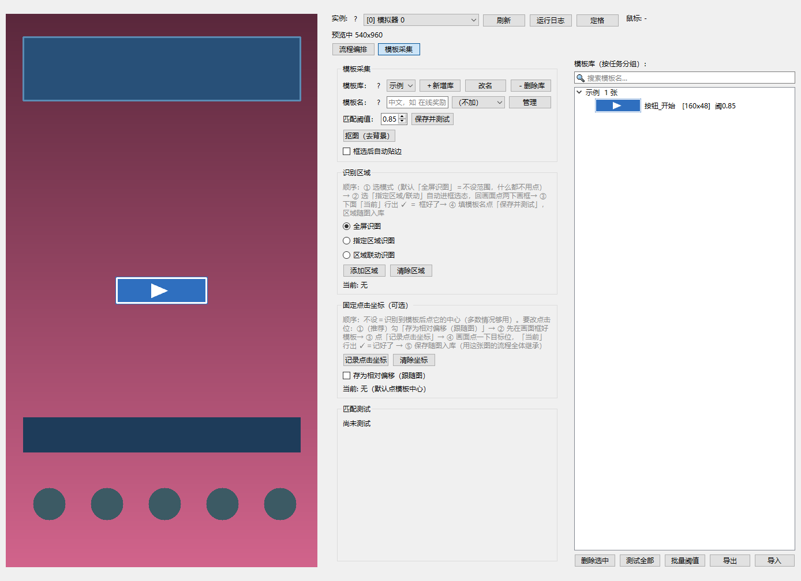

# EmuHive 多开挂机框架

Windows 10 + 安卓模拟器（雷电4/LDPlayer）的**通用多开图像识别挂机框架**：
PySide6 图形界面 + OpenCV 模板匹配，每个模拟器实例一个后台线程，互不阻塞。
任务用**可视化流程编辑器**（节点图 DSL）编排——不写一行代码，就能拼出
等图/点图/判断/循环/遍历/识字/子流程/变量算术 的完整自动化脚本。

> **免责声明**：本项目是个人学习与技术研究成果。对具体游戏/应用使用自动化
> 可能违反其服务条款，导致封号或其他后果，责任自负；请仅在你拥有充分授权
> 的场景（自有应用测试、私服/单机、厂商允许的工具链）使用。本仓库**不含任何
> 游戏截图、素材或成品流程**——模板图与流程全部由使用者自己采集、自己编排。

## 界面速览

> 下面三张截图全部由**内置演示数据**渲染（合成账号/合成流程/现画模板图，
> `python tools/readme_shots.py` 可随时复现）——不含任何真实游戏素材，
> 也正是你首次启动时看到的样子。

### 主界面 · 多开总控



- **左侧任务栏**：可挂机的流程清单（勾选即入队），流程库拖拽可换分类；
- **中间超级列表框**：一行一台实例——账号/区服/等级/运行任务/当前动作/完成度/状态，
  双击单元格原地编辑，TXT 拖进来即导入账号；
- **右侧按钮组**：模拟器批量启停、挂机全部暂停/恢复/停止、工具入口（工作台/状态窗/运行日志）；
- **下方面板**：功能设置（基准分辨率、点击带驻延时、挂机循环节拍、多开台数、雷电路径）
  与测试设置（容量压测入口）——程序全部设置不散落别处。

### 工作台 · 流程编排（节点图）



- **左预览**：对所选实例 adb 实时取帧（540×960 基准）——挂机看的是同一帧，所见即所得；
- **中画布**：拖节点、连边拼脚本。图中即「等图 → 判断弹窗在不在 → 分流点图/等待 →
  计数/发信号 → 结束」的分支流程；节点按类型着色，判断的 Y/N 两条虚线边一眼可辨；
- **右帮助**：本流程便签 + 画布操作说明，悬停节点看该类型详细参数说明；
- **底部校验条**：保存前就报缺图/断线/空标签，不留到运行时才发现。

### 工作台 · 模板采集



- 预览画面上**鼠标框选即存模板**（可开自动贴边对齐像素边界），阈值/RGB 颜色校验/
  识别区域/固定点击偏移都在同一页；
- 右侧模板库按「库」分组管理：测试全部/批量调阈值/导出导入；死图圈定走
  `python -m core.vision health`。

## 快速开始

```bash
pip install -r requirements.txt   # 官方源慢就换清华源 -i https://pypi.tuna.tsinghua.edu.cn/simple
python main.py                    # 启动 GUI（唯一正式入口；也可直接双击 run.bat）
```

前置：装好雷电4模拟器并开启 ADB 调试。首次使用四步走：

1. 主界面「设置台数」→ 启动模拟器实例；
2. 工作台 → 框选采集：从模拟器画面抠图存成模板（自动对齐 540×960 基准分辨率）；
3. 工作台 → 编流程：拖节点连边（可从 `examples/示例流程包.zip` 先导一个示例感受结构，
   入口 = 流程列表下方「导出/导入」按钮，或列表空白处右键）；
4. 勾上流程开挂。预览窗口实时看每台的识别结果与运行日志。

## 核心能力

- **多开并行**：每实例独立 QThread + 错峰启动节拍；20~30 台规模按「CPU 核数与
  adb 通道」瓶颈设计，节流旋钮齐（frame_interval / launch_interval / OCR 预算）。
- **取帧 = adb 单次快照**：`adb shell screencap -p` 直通 stdout（约 140ms/帧），
  挂机不依赖模拟器窗口，叠放/遮挡/最小化都不影响；老 adb PTY 换行污染可无损还原。
- **流程 DSL**：分支/循环(含 continue 与区间条件)/遍历全部/OCR 取数/多点取色/
  动态手指检测/子流程(带参数)/变量算术/坐标变量点击/发信号即停/并行监视容器。
- **资产保险丝**：模板账本与流程库每次覆写前自动快照（各留 30 份），改坏可拷回找回。
- **流程包导入导出**：一条流程连同引用的模板图打成一个 zip 跨机器搬迁（见 examples）。
- **容量压测**：`python tools/bench_capacity.py` 量出本机稳定台数再加功能。

## 验证与测试

无测试框架，靠 70+ 个离屏冒烟脚本（`tests/smoke_*.py`）常驻自检，改完一轮整批过：

```bash
QT_QPA_PLATFORM=offscreen python -c "import glob,subprocess,sys; fails=[f for f in sorted(glob.glob('tests/smoke_*.py')) if subprocess.run([sys.executable,f]).returncode]; print('FAILED:',fails or '无'); sys.exit(1 if fails else 0)"
```

## 打包分发

双击 `build.bat` → `dist\EmuHive\` 整个文件夹拷走即用（不带 configs/templates，
新机器首启为全新状态）。注意 1607/老机器兼容：打包环境必须按
`requirements-build311.txt` 建 Python 3.11 + PySide6 6.4.3 的 `_build311` venv。

## 目录结构

| 目录 | 内容 |
|---|---|
| `core/` | 无 Qt 底层：模拟器控制、取帧、模板匹配、OCR、账本、配置 |
| `bot/` | 线程侧：工作线程、图引擎（`tasks/flow.py`，唯一任务类型） |
| `ui/` | 界面：主窗口、工作台（采集+编排）、各类面板 |
| `tests/` | 冒烟脚本（离屏跑，不碰模拟器） |
| `tools/` | 容量压测、视频抽帧、AI 做流程流水线辅助 CLI |
| `docs/` | 流程制作指南 / JSON 速查 / 风格规范 |
| `examples/` | 示例流程包（演示 zip 结构，见 examples/README.md） |

## License

[MIT](LICENSE)
